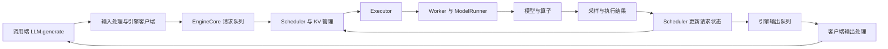

**第一课：一次生成请求如何运行——Prefill、Decode、KV cache 与 vLLM V1**

本文保留为早期 Markdown 稿件。正式课程使用重新编写的 [HTML 教材版](01-inference-lifecycle.html)，后续讲解与作业以该 HTML 为准。

本课属于第 1 学习周，预算 5 小时。目标是建立后续阅读调度、缓存、并行与内核的共同模型。工作案例为 DeepSeek-V4.1-Flash 和 GLM-5.3-Flash；本课的公式与最小实验先使用标准全 Attention 的 Dense/GQA 模型。

完成后，你应该能画出请求执行链，解释首 token 从哪里产生，算出简单模型的 KV 容量，区分请求延迟与批次吞吐，并找到 vLLM V1 的核心调度循环。本课不要求掌握 CUDA，也不要求先编译源码。

| 时间 | 任务 | 产物 |
| --- | --- | --- |
| 15 分钟 | 基础诊断 | 记录已知与不确定的地方 |
| 60 分钟 | 阅读下面的原理与例题 | 执行草图与容量手算 |
| 75 分钟 | 五个源码入口 | 方法职责与进程边界笔记 |
| 120 分钟 | 版本盘点、容量核对、单卡基线 | 配置、原始数据与四组结果 |
| 30 分钟 | 自测、解释结果和复盘 | 填写第一课报告 |

实验的 120 分钟可分为环境记录 25 分钟、估算核对 15 分钟、基线运行/分析 60 分钟、整理原始数据 20 分钟。已有工作镜像优先；复杂安装问题占用本周预算时，记录问题并把硬件部分顺延，不额外追加作业。

**先做一次诊断**

不用查资料，分别写下对这五个问题的回答。未知可以直接标注，不需要先补完课程才能继续。

1. 一个形状为 `[8, 1024, 4096]` 的 BF16 张量，占多少字节？`transpose` 一定复制数据吗？
2. CUDA/NPU 的主机调用返回，是否一定意味着设备计算已结束？
3. 你所说的 TP=8，在模型中具体切分哪些张量？它会产生哪些通信？
4. 模型权重能够装进显存，是否足以证明它能服务目标上下文和并发？
5. 增加 batch 后，总 token/s 上升，是否能推出单个用户更快？

第 1、2 题将在第 2 周补齐，第 3 题在第 12 周落实到源码，第 4、5 题在本课开始建立答案。诊断用于安排深度，不能用一次答错判定已有知识无效。

**从一个真实工作问题开始**

设想你接到这样的任务：“模型已经能启动，但首字慢，长上下文下吞吐下降；换到 910C 后，表现又不一样。”分析前需要分清三类事情：

- 模型定义如何从输入产生 logits，例如 Attention、MoE 和线性层。
- 推理引擎如何组织多个请求，例如选取 token、管理缓存和安排执行。
- 硬件与运行栈如何执行这些操作，例如 kernel、Graph、存储层次和通信。

相同模型实现可以因调度、缓存布局、batch、backend 或拓扑不同而呈现不同性能。你之后的工作是把现象定位到这条执行链中的具体位置。

**一、标准自回归模型如何产生 token**

先限定条件：decoder-only、全因果 Attention、没有前缀命中、没有投机解码，生成一个序列。

输入 prompt 为 `x1, x2, …, xP`。模型处理这 P 个 token，最后位置的 logits 用于选择第一个输出 `y1`。这段输入处理叫 Prefill。

得到 y1 后，为得到 y2，把 y1 输入模型，同时读取已有历史的 K/V。随后输入 y2 得到 y3，依次继续；这段逐步生成叫 Decode。

| 计算步骤 | 本次输入 | 计算前的逻辑 KV | 计算后的逻辑 KV | 新采样的输出 |
| --- | --- | --- | --- | --- |
| Prefill | x1…xP | 空 | x1…xP | y1 |
| 第一次 Decode | y1 | x1…xP | x1…xP、y1 | y2 |
| 第二次 Decode | y2 | x1…xP、y1 | x1…xP、y1、y2 | y3 |

需要抓住一个细节：**采样出某个 token，不表示它已经经过下一次 forward 并写入 KV。**在上面的朴素流程中，生成 N 个输出通常需要一次完整 Prefill 与 N−1 次 Decode；产生最后输出时，已计算的缓存位置通常是 P+N−1。预留 lookahead、分页分配、Chunked Prefill 和投机解码会改变分配或执行细节，不能把这个步骤计数直接当成所有实现的调度次数。

Prefill 内部可以把多个输入位置的线性层等计算组织成矩阵操作；因果 mask 约束可见范围。普通自回归 Decode 的下一 token 依赖前一个输出，需要多次迭代。迭代次数直接影响生成延迟。

**二、KV cache 保存什么，解决什么问题**

对一层标准 Attention：

\[
Q=XW_Q,\quad K=XW_K,\quad V=XW_V
\]

\[
\mathrm{Attention}(Q,K,V)=\mathrm{softmax}(QK^\top/\sqrt{d_h}+M)V
\]

`M` 是因果 mask，`d_h` 是每个 head 的维度。Decode 的新 query 需要访问历史 K/V。缓存历史 K/V 后，可以只计算新 token 对应的 K/V，再与历史缓存一起使用；无需每一步重新执行整个历史前缀的模型计算。

KV cache 保存的是各相关层的 K/V 或模型专用缓存表示。它不是模型权重，也不是把所有中间激活都永久保存。新 query、当前层激活、算子 workspace 仍然需要计算或分配。

记住以下几种存储的用途：

| 对象 | 用途 | 常见生命周期 |
| --- | --- | --- |
| 模型权重 | 定义模型参数 | 模型驻留期间 |
| 请求 KV/状态 | 保存历史推理状态 | 请求存活或缓存复用期间 |
| 激活与 workspace | 当前计算所需的输入、中间结果和临时空间 | 一个或若干执行步骤 |
| Graph 与运行时资源 | 支持捕获执行、内存管理、通信等 | 引擎运行期间 |

缓存消除了重复计算，同时引入持续增长或维护的状态。这是调度、容量和缓存管理必须一起设计的原因。[PagedAttention 原论文](https://arxiv.org/abs/2309.06180)进一步讨论了动态缓存的碎片和共享问题；本周只需了解问题，第 7–8 周再读实现。

**三、亲手计算 KV 容量**

设所有 L 层都是标准全 Attention，K/V 采用相同维度和 dtype，没有跨请求共享，没有 TP/CP 分片或压缩。

| 符号 | 含义 | 单位 |
| --- | --- | --- |
| L | Attention 层数 | 层 |
| Hkv | 每层 KV heads 数 | head |
| dh | 每个 K/V head 的维度 | 元素 |
| s | 一个 K/V 元素字节数 | byte/元素 |
| Ti | 请求 i 当前保留的已计算位置数 | token |

\[
M_{KV}=2\times L\times H_{kv}\times d_h\times s\times\sum_i T_i
\]

开头的 2 表示 K 和 V。使用 GQA 时，要用 KV heads 数，不能用 query heads 数。只有某一具体架构满足相应关系时，才能由 hidden_size/head 数反推出 dh；优先读配置中的显式 head_dim。

**例题 A：教学模型。**L=32，Hkv=8，dh=128，BF16 的 s=2 byte。每个 token 的 KV 为：

\[
2\times32\times8\times128\times2=131072\ \mathrm{byte}=128\ \mathrm{KiB}
\]

8 个请求各保留 4096 个位置时：

\[
128\ \mathrm{KiB}\times4096\times8=4\ \mathrm{GiB}
\]

请求长度不同时使用长度之和，而不是把所有请求都当作最长请求。教学分页大小设为 16 token 时，物理 token 槽位数可近似写为：

\[
\sum_i\left\lceil T_i/16\right\rceil\times16
\]

最后一个块可能未填满。真实 backend 的对齐、元数据、共享、预留槽和分组规则还会引入其他差异。

**例题 B：小型 Qwen3 配置。**[官方 Qwen3-0.6B config](https://huggingface.co/Qwen/Qwen3-0.6B/raw/main/config.json)给出 L=28、Hkv=8、dh=128；若 KV 使用 BF16，则每 token 为 114688 byte，即 112 KiB。4 个请求各保留 1024 个位置时，理想 KV 为 448 MiB。运行时读取的 config 和实际 KV dtype 是最终依据。

权重容量也需要计算。示例模型有 7×10^9 个驻留参数，全部 BF16，原始权重约 14×10^9 byte，约 13.04 GiB。加上例题 A 的 4 GiB KV，已达约 17.04 GiB，仍未计入激活、workspace、Graph、通信 buffer 和余量。MoE 的总驻留参数不能用激活参数量代替。

完整容量分析至少考虑：

\[
M_{peak}\approx M_{weights}+M_{KV/state}+M_{activation/workspace}+M_{graph/runtime}+M_{margin}
\]

这是分项分析模型，各项会依实现共享或复用资源，需要峰值测量。vLLM 可能提前分配较大的 KV 池，因此设备工具显示的占用与请求当前逻辑 KV 不是同一个量。请求完成后缓存块可被回收或保留复用，设备预分配池也未必随之缩小。

**四、为什么 Prefill 和 Decode 常常表现不同**

相同权重面对许多新输入位置时，线性层可组织较大的矩阵操作，更容易摊薄权重读取与调用成本。普通 Decode 每个请求每步只提供少量新 token；batch 较小时，权重复用机会少，历史 KV 读取和设备调用成本也可能显著。

标准全 Attention 的 Prefill 注意力部分随输入长度近似呈平方增长；Decode 的注意力部分则随当前保留历史长度增长。线性层、稀疏/压缩/窗口机制和硬件实现还会影响总体成本。

所以可以先提出“长输入是否受 Prefill 计算影响”“小 batch Decode 是否受带宽或启动开销影响”等假设。**Prefill 一定算力受限、Decode 一定带宽受限**不是可直接采用的结论；要根据模型、长度、batch、通信和 profiler 判断。

本周观察几个方向即可：

- 输入变长时，请求增加了哪些计算和状态？
- batch 增大时，是否获得了权重读取复用，是否增加了 KV 和等待？
- 增加设备时，哪些资源增加了，哪些通信同时增加了？

**五、先把测量口径说清楚**

定义 t0 为请求开始时间，t1 为观察到第一个输出 token 的时间，tN 为最后一个输出 token 的时间，tdone 为请求完成时间。N 为实际输出 token 数。

\[
TTFT=t_1-t_0
\]

\[
TPOT=(t_N-t_1)/(N-1),\quad N>1
\]

\[
ITL_j=t_j-t_{j-1},\quad j\ge2
\]

\[
E2E=t_{done}-t_0
\]

如果在客户端测量，TTFT 包含网络、前处理、排队、Prefill 和首输出传递等影响，不能将其直接等同于 Prefill kernel 时间。本地 `metrics/stats.py` 的 mean_time_per_output_token 使用首个到最后一个生成事件间隔，分母排除 Prefill 产生的第一个 token；客户端 benchmark 的时间边界要单独核对。

例子：5 个 token 的到达时间为 125、145、165、185、205 ms，请求在 0 ms 开始，并在 205 ms 完成，则 TTFT=125 ms、TPOT=20 ms、E2E=205 ms。如果 N=1，TPOT 没有这个数学定义；实现可能用 0 表示占位，不能解释为真实的零生成成本。

对于固定时间窗口：

\[
\mathrm{aggregate\ output\ tokens/s}=\mathrm{输出token总数}/\mathrm{窗口时长}
\]

批次总输出吞吐可以随着 batch 增加而上升，单请求延迟仍可能变长。真实流式协议也可能一次 chunk 携带多个 token，测 chunk 间隔时需说明与逐 token ITL 的区别。

本周的离线脚本等待整个批次完成后计时，只能提供 batch wall time 和聚合 output tokens/s。它包含 Prefill、Decode 及调用端输出处理；不能从总耗时除以输出长度得到流式 TTFT、ITL 或纯 Decode 性能。第 4 周用在线流式工具建立这些指标。

**六、vLLM 在这条链路中的位置**

下图表示请求、执行和结果的数据流，不能当作同一线程中的同步 Python 调用栈。基于单个 DP 引擎的概念图；实际通信方式取决于配置。



EngineCore 负责调度、缓存管理和执行协调；Worker/Runner 负责设备侧模型运行。客户端负责请求输入和结果处理。V1 的这些职责通常通过多进程分开，参见[官方进程架构说明](https://docs.vllm.ai/en/stable/design/arch_overview/)；本课的准确方法路径以本地快照为准。

重要的源码事实：`LLMEngine.step()` 与 `EngineCore.step()` 是不同层的步骤。当前本地前者通过 `engine_core.get_output()` 接收输出，并交给 output_processor；EngineCore 的独立循环推进设备执行。不能把二者画成没有 IPC 的直接调用。

**七、五个必读源码入口，75 分钟封顶**

下面的行号是本轮快照定位，后续变化时以类与方法名为准。

| 用时 | 文件与方法 | 本周只回答的问题 |
| --- | --- | --- |
| 10 分钟 | [LLM.generate](../../vllm-main-261013/vllm/entrypoints/llm.py)，约第 418 行 | 用户入口把什么交给 `_run_completion`？ |
| 15 分钟 | [OfflineInferenceMixin._run_completion / _run_engine](../../vllm-main-261013/vllm/entrypoints/common/offline.py)，约第 340 / 589 行 | 请求如何加入；循环何时结束；为何结果是完成后的批次输出？ |
| 10 分钟 | [LLMEngine.step](../../vllm-main-261013/vllm/v1/engine/llm_engine.py)，约第 319 行 | 它从哪里接收输出；做哪些客户端处理？ |
| 25 分钟 | [EngineCore.step](../../vllm-main-261013/vllm/v1/engine/core.py)，约第 657 行 | Schedule、Execute、Sample、Update 如何组成闭环？ |
| 15 分钟 | [Scheduler.schedule 开头](../../vllm-main-261013/vllm/v1/core/sched/scheduler.py)，约第 591 行 | `num_computed_tokens`、`num_tokens_with_spec` 与 token budget 各表示什么？ |

在代码阅读器使用 `rg -n 'def generate|def _run_completion|def _run_engine|def step|def schedule'` 配合具体文件定位。不要在本周继续展开整个 Scheduler、Runner 或 kernel。

把 EngineCore 的关键逻辑摘出来，省略 grammar、abort、日志等分支：

```python
scheduler_output = self.scheduler.schedule(self._should_throttle_prefills())
future = self.model_executor.execute_model(scheduler_output, non_block=True)
# ... grammar 与其他处理 ...
model_output = future.result()
if model_output is None:
    model_output = self.model_executor.sample_tokens(grammar_output)
engine_core_outputs = self.scheduler.update_from_output(
    scheduler_output, model_output
)
```

这是省略后的阅读片段，不能替换原实现。它显示的闭环是：决定执行什么 → 发起模型执行 → 收集/采样结果 → 更新请求与缓存状态 → 返回结果并进入下一次迭代。还有 batch queue/async 路径，第 9 周再对照。

Scheduler 开头的注释用统一 token 进度解释调度：请求拥有已计算的 token 数以及包含输入、输出、投机 token 的目标进度。调度器为请求分配 token，让计算进度追上目标。本课保留 Prefill/Decode 作为推理概念，同时认识到 V1 的调度实现不要求两套独立的 phase 分支。

例如一个没有缓存命中的请求，prompt 长 128：初始需计算 128 个位置；完整 Prefill 后采样出 y1，此时已计算 128，已知输入+输出为 129；下一轮通常还需计算 y1 这个位置。这就是统一进度表达能够覆盖 Prefill 与普通 Decode 的直观原因。字段更新的精确时间在第 6 周再读。

本周输出一张表：每个方法属于调用端还是引擎端，接收什么对象，返回什么对象，哪个方法安排 token，哪个方法运行模型。方法名称相同不代表职责相同。

**八、把基础与两个工作模型建立联系**

本课的标准流程和容量公式是学习锚点。你的工作模型需要在这个锚点上增加模型专用执行与状态：

| 工作案例 | 已定位的本地证据 | 本周需要意识到的边界 |
| --- | --- | --- |
| DeepSeek-V4.1-Flash | [模型入口](../../vllm-main-261013/vllm/models/deepseek_v41/__init__.py)、[sparse_mla](../../vllm-main-261013/vllm/models/deepseek_v41/sparse_mla.py)、[decoder replay](../../vllm-main-261013/vllm/models/deepseek_v41/decoder_replay_layers.py) | 有模型专用压缩/稀疏缓存和执行路径，不能用“所有层都保留同样 K/V”估总缓存；官方介绍采用非对称 Causal Encoder–Decoder 结构 |
| GLM-5.3-Flash | [glm5next 入口](../../vllm-main-261013/vllm/models/glm5next/__init__.py)、[common/model](../../vllm-main-261013/vllm/models/glm5next/common/model.py)、[KDA](../../vllm-main-261013/vllm/models/glm5next/common/kda.py) | 模型代码根据 layer_types 区分 KDA/MLA，缓存状态需按层类型分析，不能全用标准 GQA 公式 |

DeepSeek 的非对称结构是[官方模型介绍](https://www.deepseek.com/news/deepseek-v4-1-flash/)给出的说明；本地具体实现是否与用户 checkpoint/revision 一致仍要核对。上述额外文件本周只作定位索引，深入阅读安排在后续课表，不计入五个必读文件。

你可以读取实际 checkpoint 的 `architectures` 和层类型，记录名称，暂不要求推导所有缓存平面。模型商品名、类名、目录名之间的映射，是模型适配的第一步。

**九、实验 1：不用加速器核对容量**

脚本只用 Python 标准库。以下命令在 Linux 学习目录下运行；Windows 对应使用 `.venv\Scripts\python.exe`。Python 通过 uv 创建的环境运行，不需要安装 vLLM。

```bash
uv venv .venv
.venv/bin/python labs/lesson01_estimate.py
.venv/bin/python labs/lesson01_estimate.py --tokens 4097
.venv/bin/python labs/lesson01_estimate.py --layers 28 --kv-heads 8 \
  --head-dim 128 --tokens 1024 --requests 4
```

第一个输出应为每 token 131072 byte、理想 KV 4 GiB。第二个例子使用每请求 4097 个位置，理想容量约 4.00098 GiB，但按 16 token 块取整约 4.015625 GiB。第三个例子为 0.4375 GiB，即 448 MiB。

再手算两个变化：KV heads 从 8 减为 1，会怎样？请求数从 8 增为 16，会怎样？写出倍率与条件。不能把这些比例套到 MLA、混合状态、压缩量化或跨请求共享。

**十、实验 2：已有镜像内完成单卡离线基线**

实验选择 H20 或 910C 上当前最方便使用、已验证的小模型环境。本周完成一个主要平台即可；另一平台的重复实测作为后续对照。910B 是补充平台。不要用本课的参数直接重启现有大型生产服务。

第一步，在 NVIDIA 与 Ascend 镜像分别记录实际版本，至少优先完成本周实验镜像。用户提供的 vLLM 0.31.0、插件 0.30.0rc1 是起始记录；[版本表](https://docs.vllm.ai/projects/ascend/en/main/community/versioning_policy.html)将插件 0.30.0rc1 对应到 vLLM 0.30.0，因此以镜像内安装结果确认完整组合。

课程脚本放在独立学习目录。在已验证镜像里创建继承已安装依赖的环境，`/path/to/validated/python` 替换为这个镜像原本使用的 Python 解释器；保持相同的 Python ABI 与软件栈，不在本周重新安装整套依赖。

```bash
uv venv --system-site-packages --python /path/to/validated/python .venv
.venv/bin/python -c 'import importlib.metadata as m; import sys; print(sys.version); print({n: m.version(n) for n in ("vllm", "torch", "transformers")})'
.venv/bin/python -c 'import torch; print("torch CUDA runtime:", torch.version.cuda)'
```

Ascend 镜像另行记录插件与 torch_npu：

```bash
.venv/bin/python -c 'import importlib.metadata as m; print({n: m.version(n) for n in ("vllm", "vllm-ascend", "torch", "torch-npu")})'
npu-smi info
cat /usr/local/Ascend/ascend-toolkit/latest/version.cfg
```

CANN 安装路径随镜像变化；上述文件不存在时，读取镜像安装清单或实际 toolkit 路径。NVIDIA 使用 `nvidia-smi` 记录设备与驱动，必要时用 `nvcc --version` 记录已安装 toolkit。`nvidia-smi` 显示的 CUDA Version 是驱动支持的版本标识，不能当作 PyTorch 运行时或镜像 toolkit 的安装版本。[NVIDIA nvidia-smi 文档](https://docs.nvidia.com/deploy/nvidia-smi/index.html)

第二步，准备已有的本地小型 Dense checkpoint。建议 Qwen3-0.6B，确认镜像支持该模型；使用另一标准 Dense/GQA 模型时记录替换理由。大型工作模型另设容量与并行参数，不能直接套用本脚本。

第三步，只暴露一张空闲卡，在 Linux 中运行以下二选一命令。`/models/Qwen3-0.6B`、镜像标识和模型 revision 替换为实际值。运行目录是课程目录；按真实模型目录读取，不在脚本里自动下载模型。

H20：

```bash
CUDA_VISIBLE_DEVICES=0 .venv/bin/python labs/lesson01_baseline.py \
  --model /models/Qwen3-0.6B --output records/lesson01-h20-run01.json \
  --image-id '实际镜像tag或digest' --model-revision '实际模型revision'
```

910C 或补充 910B：

```bash
ASCEND_RT_VISIBLE_DEVICES=0 .venv/bin/python labs/lesson01_baseline.py \
  --model /models/Qwen3-0.6B --output records/lesson01-910c-run01.json \
  --image-id '实际镜像tag或digest' --model-revision '实际模型revision'
```

脚本使用公开 `LLM` 接口，具体兼容性须在配套镜像确认。假如 import、模型支持、设备或版本检查失败，记录原错误和版本信息，不在本周盲目升级整套栈。结果文件使用新名字，不覆盖已有数据。

固定配置：TP=1、BF16、max_model_len=2048、最大 batch 请求数 4、禁用前缀缓存、enforce_eager=True、固定 seed、每请求恰好生成 32 个 token。合成 token 输入在计时前构造；它用于控制负载，不是质量评测。Eager 基线便于减小 Graph 路径干扰，不代表最终优化配置；其他默认调度配置以有效配置和启动日志为准。

| 条件 | 每请求输入 P | 每请求输出 N | 批次请求 B |
| --- | --- | --- | --- |
| A | 128 | 32 | 1 |
| B | 128 | 32 | 4 |
| C | 1024 | 32 | 1 |
| D | 1024 | 32 | 4 |

每组先预热一次，再测三次，总共 12 条测量数据。模型初始化单独记录。脚本核对实际输入和输出长度，并保存原始值、中位数、版本及配置。三次数据适合本课初步观察，不足以估计可靠 P95/P99 或生产稳定性。

只比较 A/B 观察 batch，比较 A/C 观察输入长度。先不要同时改变量化、并行、Graph 和 token budget。不要预填任何性能数值，也不要把输出字符数当 token 数。

**如何解释结果**

如果 B 比 A 的总输出吞吐更高，可能与权重复用、设备利用率或调用成本摊薄有关；本周数据还不能证明具体原因，也不能判断每个请求的流式延迟。如果 C 比 A 耗时更长，差异同时可能来自 Prefill 与后续更长的历史 KV 访问，不能将差值直接写成纯 Prefill 时间。

没有观察到预期趋势也可以提交。记录幅度、重复间波动、CPU 或设备是否被其他负载使用，以及下一步要增加什么测量。下一课继续讲张量布局和异步执行，第 4 周补充流式指标。

**十一、提交与验收**

复制填写[报告模板](../records/lesson01-report-template.md)，提交以下内容：五题诊断；请求执行链及客户端/引擎边界；两个容量手算；五个源码方法职责；环境记录与四组原始结果；一个性能假设和验证它需要的新测量。

自测题：

1. 为什么 y1 来自 Prefill？刚采样的 y1 是否已经有 KV？
2. 例题 A 为何使用 8 个 KV heads，而不是 query heads 数？
3. 为什么权重装得下不代表目标并发和上下文可服务？
4. `LLMEngine.step()` 是否直接调用 `EngineCore.step()`？请用本地方法说明。
5. V1 如何用 token 进度同时表达 Prefill 和 Decode？
6. 为什么本周离线脚本不能测 TTFT？总 output tokens/s 上升能证明每个请求更快吗？
7. 为什么不能用例题 A 的公式直接估算 DeepSeek-V4.1-Flash 或 GLM-5.3-Flash 的全部缓存？

通过标准：第 1–3、6–7 题能够独立解释，第 4–5 题能定位源码；容量例题单位正确；完成一个实际平台的四组基线并保留配置/数据；对性能解释区分观察、假设与待验证。设备实验尚未完成时保留为待完成，不把 CPU 估算标成完整硬件验收。

<details>
<summary>完成自测后再展开：参考要点</summary>

- 标准完整 Prefill 计算 prompt 的最后位置 logits，采样 y1；y1 要在后续 forward 才拥有自己的 K/V。
- GQA 用 KV heads 确定 K/V 存储量，query heads 不等于 KV heads。
- 权重之外还需要缓存、激活、workspace、图与运行时资源；MoE 驻留权重不能只算激活参数。
- 本地 LLMEngine.step 从 EngineCoreClient 接收结果；EngineCore 独立调度并执行，IPC 数据流不等于直接函数调用。
- 没有命中的完整 prompt 起初有多个待计算 token；普通 Decode 通常只有新输出 token 待计算，统一使用进度差与预算表达。
- 离线 generate 返回批次完成结果，没有首 token/逐 token 时间戳；聚合吞吐与单请求延迟是不同指标。
- 工作模型包含模型专用压缩、稀疏或混合状态，应按真实层类型、缓存平面、精度和分片重新建模。

诊断补充：`8×1024×4096×2=67108864 byte=64 MiB`。PyTorch transpose 通常产生改变 stride 的 view，后续 contiguous/某些算子可能导致复制。设备主机调用可能异步；TP 的实际切分与通信必须追踪具体层实现。

</details>
